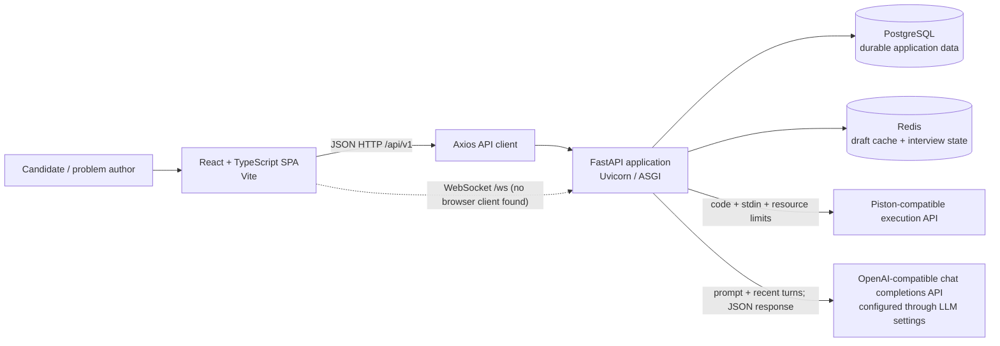
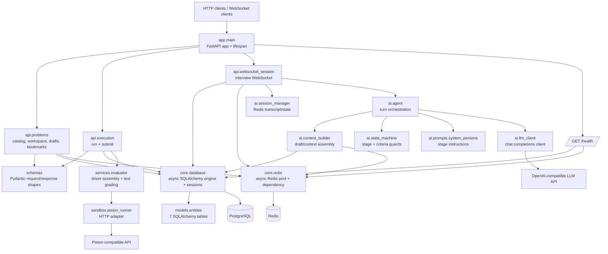
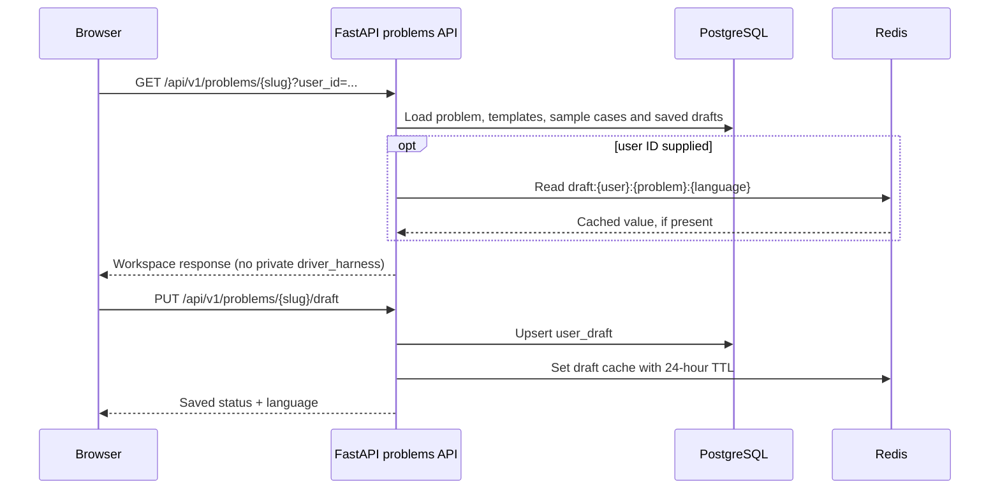
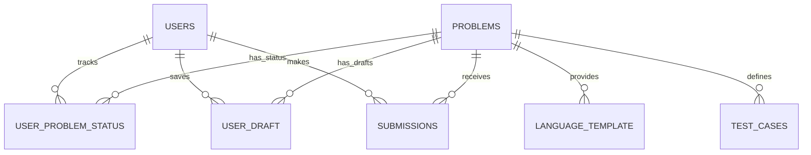

# FLeet System and Backend Architecture

This map describes the repository's implemented structure. It distinguishes code that exists in the backend from functionality currently wired into the browser UI.

## System context

### Runtime boundaries

| Boundary | Responsibility | Repository evidence |
|---|---|---|
| Browser application | Problem-list UI and typed API client | `frontend/src/main.tsx`, `frontend/src/App.tsx`, `frontend/src/components/ProblemList.tsx` |
| Backend application | HTTP, WebSocket, persistence, grading and interview orchestration | `backend/app/main.py` and `backend/app/` |
| PostgreSQL | Users, problems, templates, test cases, drafts, status and submissions | SQLAlchemy models in `backend/app/models/entities.py` |
| Redis | Cached drafts and temporary interview transcript/state/hint summary | `backend/app/core/redis.py`, `backend/app/ai/session_manager.py` |
| Code execution service | Runs submitted source in a separate sandbox service | `backend/app/sandbox/piston_runner.py`; URL configured by `PISTON_URL` |
| LLM service | Generates structured interviewer turns using chat completions | `backend/app/ai/llm_client.py`; URL/model configured by settings |

Locally, the repository's Compose file starts PostgreSQL and Redis. The README starts the frontend and backend as separate development processes; the Piston-compatible service and LLM API are external dependencies. No deployment manifests or production topology are defined in the repository.

## Backend component map

### Backend layers

| Layer | Modules | Role |
|---|---|---|
| Application/bootstrap | `backend/app/main.py` | Creates the FastAPI app, includes routers, creates ORM tables during startup, disposes database/Redis resources during shutdown, registers the sandbox-unavailable error handler and health endpoint. |
| API adapters | `backend/app/api/` | HTTP endpoints for problems/workspaces and code execution; WebSocket endpoint for interview turns. |
| Contracts | `backend/app/schemas/` | Pydantic request/response models; workspace responses intentionally omit the private language driver harness. |
| Business services | `backend/app/services/evaluator.py` | Combines submitted code with the stored driver, runs test cases, compares output and maps failures to verdicts. |
| External adapters | `backend/app/sandbox/` and `backend/app/ai/llm_client.py` | Async HTTP clients for the Piston-compatible execution API and OpenAI-compatible LLM API. |
| Interview orchestration | `backend/app/ai/` | Loads session data, builds bounded prompt context, applies stage/criteria transitions and records turn results. |
| Persistence/infrastructure | `backend/app/core/`, `backend/app/models/` | SQLAlchemy async sessions, Redis pool and ORM table definitions. |
| Configuration | `backend/app/config.py` | Environment-backed settings for database, Redis, sandbox URL and LLM endpoint/model/key. |

### Backend entry points and contracts

All REST endpoints below are mounted by `backend/app/main.py`.

| Method / path | Purpose | Important behavior |
|---|---|---|
| `GET /health` | Dependency health check | Executes `SELECT 1` and Redis `PING`; response reports PostgreSQL and Redis status. |
| `POST /api/v1/users/demo` | Create or retrieve a demo user | Returns the user ID and username. |
| `POST /api/v1/problems` | Create a problem and its language templates/test cases | Returns the new problem ID and slug; rejects an existing slug. |
| `GET /api/v1/problems?user_id=...` | List problems with optional user status | Returns difficulty, status, favourite and solve-again fields. |
| `GET /api/v1/problems/{slug}?user_id=...` | Fetch problem workspace | Returns public language boilerplate and sample cases; drafts come from PostgreSQL with Redis values preferred when available. |
| `PUT /api/v1/problems/{slug}/draft` | Save a code draft | Upserts PostgreSQL first, then writes a 24-hour Redis cache entry. |
| `PATCH /api/v1/problems/{slug}/bookmark` | Update favourite/solve-again flags | Upserts the user's problem-status row. |
| `POST /api/v1/problems/{slug}/run` | Run against sample cases or custom input | Does not persist a submission. |
| `POST /api/v1/problems/{slug}/submit` | Grade against all test cases | Persists a submission and upserts status to `SOLVED` for accepted code, otherwise `ATTEMPTED`; a solved status is not downgraded by a later failed submission. |
| `WS /ws/interview/{problem_slug}/{user_id}` | Conversational interview session | Receives JSON turns (`utterance`, optional `language`, optional `sandbox_result`) and sends spoken response, current stage, transition, hint tier and anti-pattern fields. |

The REST routes use a caller-supplied user ID; no authentication middleware or authorization dependency is defined on these routes in the inspected source.

## Principal backend flows

### Problem workspace and draft

Redis is a cache, not the durable source for user drafts: the API persists drafts to PostgreSQL first and logs a warning if the cache write fails.

### Code run and submit

1. The execution API loads the problem, language template and test cases.
2. The stored `driver_harness` is concatenated after candidate code; this harness is not returned by the public workspace response.
3. `PistonRunner` sends source, stdin and configured time/memory limits to the external Piston-compatible endpoint.
4. `run` returns custom-input output or sample-case results without creating a submission.
5. `submit` evaluates test cases in order and stops at the first failure; it derives `AC`, `WA`, `TLE`, `RE` or `CE`, stores the immutable submission, and upserts user problem status.
6. If the configured sandbox cannot service the request, the application maps `SandboxUnavailableError` to HTTP 502 with a `detail` field.

### Interview WebSocket

1. The WebSocket endpoint accepts the connection and loads a state machine, transcript and hint count from Redis.
2. Each turn validates the JSON input, loads the current problem, and builds context from the Redis draft (falling back to the PostgreSQL draft), Redis interview summary, recent transcript turns and optional caller-supplied sandbox telemetry.
3. Python snippets receive AST-based syntax/function/loop metadata; non-Python source is not AST parsed. Candidate code is added to prompt context only in `LIVE_CODING` and `DRY_RUN`; telemetry is included only in `DRY_RUN`.
4. The LLM client requests a JSON chat-completions response and validates it as `AgentTurnOutput`. The state machine applies deterministic transition/criteria guards.
5. The endpoint records hint use, appends the user and assistant messages, saves the state machine, and returns the turn response.

The WebSocket handler consumes `sandbox_result` supplied by its caller; it does not invoke the code-run endpoint itself.

## Persistence model

The ORM defines seven tables in `backend/app/models/entities.py`:

| Table | Key fields and relationships |
|---|---|
| `users` | `user_id` UUID PK; unique indexed `username` and `email`; `password_hash`; optional `gender` and `about`; `created_at`. One-to-many to status, draft and submission records. |
| `problems` | `problem_id` UUID PK; unique indexed `slug`; title, difficulty enum, description, optional image URL, JSON examples, constraints, time/memory limits and creation time. One-to-many to language templates and test cases. |
| `language_template` | Composite PK `(problem_id, template_language)`; boilerplate and private driver harness; FK to problem with cascade delete. |
| `test_cases` | `test_case_id` UUID PK; problem FK; expected input/output, sample flag and ordinal order; FK to problem with cascade delete. |
| `user_problem_status` | Composite PK `(user_id, problem_id)`; optional attempted/solved status, favourite and solve-again flags, update time; FKs to users and problems. This is the user/problem association. |
| `user_draft` | Composite PK `(user_id, problem_id, language)`; code and update time; FKs to users and problems. |
| `submissions` | `sub_id` UUID PK; user/problem FKs; language, submitted source, verdict, optional runtime/memory/error and creation time; index on `(user_id, problem_id, created_at)`. |

Foreign-key cascades are declared for the child records associated with users/problems. The ORM uses PostgreSQL JSONB for the problem examples column and generic JSON for other dialects.

Redis keys observed in source:

| Key pattern | Contents / expiry |
|---|---|
| `draft:{user_id}:{problem_id}:{language}` | Cached source draft; 24 hours. |
| `session:{user_id}:{problem_slug}:state` | Current interview stage and criteria; 24 hours. |
| `session:{user_id}:{problem_slug}:history` | Interview transcript; 24 hours. |
| `interview_summary:{user_id}:{problem_slug}` | Hint count and summary fields; 24 hours. |

## Frontend boundary and integration status

- `frontend/src/main.tsx` mounts `App`; `App` currently renders only `ProblemList`.
- `ProblemList` calls `problemService.getAllProblems()`, which calls `GET /api/v1/problems`; it handles loading, fetch failure and empty results.
- `problemService` also defines workspace, draft-save and bookmark methods. The currently rendered UI does not call those methods.
- No browser code for run/submit endpoints or the interview WebSocket was found in `frontend/src`.
- `Header` renders no content and `Sidebar` returns `null`; neither is used by the current `App`.
- The Axios base URL defaults to `http://localhost:8000/api/v1` and can be overridden by `VITE_API_BASE_URL`.

## Stack and local runtime

- Backend: Python `>=3.13`, FastAPI, Uvicorn, SQLAlchemy async, asyncpg, Pydantic Settings, Redis async client and httpx. Dependency declarations are in `backend/pyproject.toml`.
- Frontend: React, TypeScript, Vite, Axios and Tailwind CSS. Versions are declared in `frontend/package.json`.
- Local infrastructure in `backend/docker-compose.yml`: PostgreSQL `16-alpine` and Redis `7-alpine`, with a persistent PostgreSQL volume and health checks.
- Backend startup calls `Base.metadata.create_all`; it does not use a migration framework in the inspected source.
- Backend tests use in-memory SQLite and fake Redis/sandbox clients, as configured in `backend/tests/conftest.py`.
- LLM settings in `backend/app/config.py` default to the Google Generative Language OpenAI-compatible base URL and `gemini-3.6-flash`; `OPENAI_API_KEY` is the configured key setting. Environment variables can override these defaults.

## Source navigation

- Application bootstrap and health: `../backend/app/main.py`
- Problem routes: `../backend/app/api/problems.py`
- Execution routes: `../backend/app/api/execution.py`
- Interview WebSocket: `../backend/app/api/websocket_session.py`
- Persistence entities: `../backend/app/models/entities.py`
- Database and Redis setup: `../backend/app/core/database.py`, `../backend/app/core/redis.py`
- Evaluator and sandbox adapter: `../backend/app/services/evaluator.py`, `../backend/app/sandbox/piston_runner.py`
- Interview pipeline: `../backend/app/ai/agent.py`, `../backend/app/ai/context_builder.py`, `../backend/app/ai/session_manager.py`, `../backend/app/ai/state_machine.py`
- Frontend entry and API client: `../frontend/src/main.tsx`, `../frontend/src/services/apiService.ts`, `../frontend/src/services/problemService.ts`
